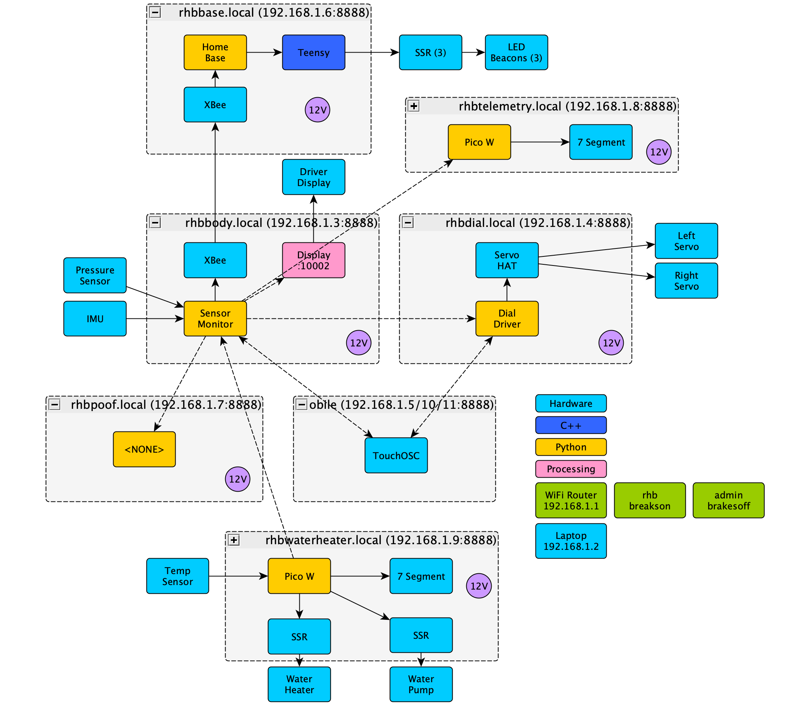

Red Hot Beverly Sensors Monitor
===============================

The Red Hot Beverly's sensor and telemetry daemon, on the Raspberry Pi in the
body of the car (`rhbbody.local`, `192.168.1.3`).

1. **Reads the sensors**: accumulator pressure, BerryIMU orientation, GPS,
   disk.
2. **Publishes over OSC** to every listener on the car.
3. **Logs everything** to CSV, including values other devices produce.
4. **Phones home**: the last position goes to the base station over XBee.

The rig
-------

| Host | Address | What runs there |
| --- | --- | --- |
| `rhbbody` | 192.168.1.3 | This monitor, plus the Processing driver display on port 10002 |
| `rhbdial` | 192.168.1.4 | Dial driver: the two gauge servos, from `/pressure` |
| `rhbbase` | 192.168.1.6 | Home base: XBee receiver and Teensy driving three LED beacons |
| `rhbwaterheater` | 192.168.1.9 | Water heater (rhb-water-heater), ESP32-S3-POE-ETH, wired: bath probe, valve SSR |
| `mobile` | 192.168.1.5, .10, .11 | TouchOSC layouts (`images/mobile_ui.touchosc`) |
| `rhbleddriver` | 192.168.1.13 | LED driver (rhb-led-driver): pixels on the hose, handle and gauge, via the F16V5 at 192.168.1.20 |
| `beverly` | 192.168.1.14 | Vehicle telemetry (rhb-vehicle-telemetry): CAN bus dashboard; sends OSC only to itself |
| `rhbpoofcontroller` | 192.168.1.15 | Poof controller (rhb-poof-controller), ESP32-S3-POE-ETH, wired: sends `/poof`, shows pressure and bath temperature |

Static addresses, router at 192.168.1.1.  `config/network.txt` is the
authoritative list; `config/*.service` are the systemd units.

Hardware on this Pi
-------------------

| Sensor | Interface | Module |
| --- | --- | --- |
| Accumulator pressure transducer | ADS1115 ADC at I2C 0x48, +/- 2.048 V, 128 SPS continuous | `pressure_sensor.py` |
| BerryIMU (LSM9DS0 or LSM9DS1) | I2C, tilt compensated heading | `imu/berryIMU.py` |
| GPS | `gpsd` via the `gps3` socket | in the main loop |
| DS18B20 one-wire probe | `/sys/bus/w1/devices/28*` | `temperature_sensor.py`, unused now that the bath owns temperature |
| PiGlow | I2C status LEDs | red = poofing, blue = GPS watchdog blink |
| XBee | `/dev/ttyUSB0` at 9600 baud | coordinator talking to the base router |

Running it
----------

    python3 rhb-sensor-monitor.py

| Option | Default | Meaning |
| --- | --- | --- |
| `--ip` | `192.168.1.3` | Address this monitor's own OSC server binds to, port 8888 |
| `--client_ip` | `192.168.1.4,.5,.8,.9,.10,.11,.13,.15` | Comma separated list of listeners |
| `--client_port` | `8888` | Port those listeners are on |
| `--display_ip` | `127.0.1.1` | The Processing driver display, normally local |
| `--display_port` | `10002` | Port the driver display listens on |

In the car, `rhb_body_driver.service` starts it from
`/home/pi/development/startup.sh` with `Restart=always`.  It logs to
`rhb-sensor-monitor.log` (200 KB x 5) and to the journal.  `RHB_DATA_DIR`
moves the log and CSVs (see "Read-only SD card").

Main loop
---------

`main_loop()` runs about every 50 ms alongside the OSC server.

| Step | Does |
| --- | --- |
| Persist | fsync histories every 5 s, roll to new files hourly |
| Pressure | Read, check the sensor is connected, look for a poof, broadcast at least every 500 ms |
| IMU | Broadcast heading when it moves more than 2 degrees from the last five's mean |
| GPS | Broadcast position on about 0.00005 degrees or 5 m of altitude, with inferred speed; set the clock hourly (no RTC) |
| Disk | `/free_disk` on change; commented out of the loop |
| Rebroadcast | Position, heading, pressure and poof count every 5 s; `lat,lon` over XBee every 50 s |

All intervals use `time.monotonic()`: the Pi boots about seven hours fast,
and when GPS set the clock back, wall clock intervals went negative and
nothing persisted until dawn.

Every peripheral call is wrapped in `@handle_exception`, so a failing sensor
logs and is retried next pass.

Poof detection
--------------

`/poof_count` counts presses of the poof button.  `ButtonPoofTrack` in
`poof_track.py` counts changes to pressed in `/poof` and adds up the time
held; only a change counts, since the controller repeats releases.  A press
broadcasts `/poof_count` immediately.

The older pressure detector, `PoofTrack`, still runs for comparison and
drives the red PiGlow LED and pressure history.  It converts counts to PSI
(`counts * 10 / 2000 + 10`, truncated to 0.1) and starts a poof more than
3 PSI from the base pressure, a rolling median of 10,000 idle readings.  The
base isn't updated while poofing.

Both write `poofs_*.csv`, tagged `button` or `pressure`.

Detecting a disconnected sensor
-------------------------------

An unplugged transducer floats and reads a plausible 0-25 PSI.
`pressure_health.py` tells them apart by smoothness: across 2023-2025
sessions a connected sensor's rolling median step stayed under 400 counts,
a floating one 2100-3030.  The threshold is 1000 counts over a 40 sample
window.  Readings near the rails (30,000 counts) and failed I2C reads also
count as bad.

20 bad samples (about 1 s) declare it gone; 40 clean ones bring it back.
While gone, a poof in progress ends, no history is recorded, and the last
good pressure keeps broadcasting.

Data logging
------------

`metric_logging.py` streams to `/home/pi/development/data` (or
`$RHB_DATA_DIR/data`), as `<kind>_YYYYMMDD_HH_MM.csv`:

| File | Columns |
| --- | --- |
| `pressure_*.csv` | timestamp, level: every reading while poofing, every 5 minutes otherwise |
| `positions_*.csv` | timestamp, lat, lon, alt, speed |
| `heading_*.csv` | timestamp, heading |
| `water_*.csv` | timestamp, temp_f, heater_status, pressure_psi |
| `disk_*.csv` | timestamp, free |
| `poofs_*.csv` | timestamp, source (`button` or `pressure`), event (`start` or `stop`), count, poof_time |

Rows are flushed as written and fsynced every 5 s, so a power cut loses a few
seconds.  Files roll hourly; an existing name (after GPS sets the clock back)
is appended to, never overwritten.  A missing or full stick is logged once
and retried.

Archived runs are in `data/`; `reporting/` has the season notebooks.

OSC message ownership
---------------------

Every address has one producer.  Nothing else emits or re-broadcasts it.

| Address | Owner | Payload |
| --- | --- | --- |
| `/pressure` | rhb-sensor-monitor | Accumulator pressure, PSI, rounded |
| `/pressure_fine` | rhb-sensor-monitor | Accumulator pressure, PSI, unrounded |
| `/poof_count` | rhb-sensor-monitor | Poof button presses since startup |
| `/poof` | rhb-poof-controller | Poof button, 1.0 pressed, 0.0 released |
| `/position/lat`, `/position/lon`, `/position/alt`, `/position/inferred_speed` | rhb-sensor-monitor | GPS fix |
| `/imu`, `/heading`, `/cardinal` | rhb-sensor-monitor | BerryIMU orientation |
| `/free_disk` | rhb-sensor-monitor | Free disk, percent |
| `/temperature` | rhb-water-heater | Water bath temperature, deg F.  The only temperature on the network |
| `/water_heater` | rhb-water-heater | Bath valve open/shut |
| `/upper_temp`, `/lower_temp` | rhb-water-heater | Configured bath setpoints, deg F |
| `/water_pressure` | rhb-water-heater | Bath loop pressure, PSI |
| `/tick/dial`, `/dial_temperature_cpu` | rhb-dial | That device's own health |

- Listeners off port 8888 are `host:port` in a client list, e.g.
  `192.168.1.3:10002`.
- Match addresses exactly: `pressure` is a substring of `/water_pressure`
  and `/pressure_fine`.
- `broadcast()` isolates every send and won't raise on an unencodable value,
  so one bad listener can't silence the rest.  Without that the gauges keep
  working while `/poof_count`, late in the client list, silently sits at 0.
- This monitor logs the water bath into `water_*.csv` but publishes none of
  it, and never re-broadcasts `/poof`.  Unexpected addresses are logged.

WiFi listeners must not sleep
-----------------------------

A WiFi board in power save answers ARP hundreds of milliseconds late.  Linux
senders retry and don't notice; a W5500 sender gives up inside `sendto`.  Any
mains powered WiFi listener disables power save at startup:

    wlan.config(pm=network.WLAN.PM_NONE)

Symptom: one sender reaches a listener and another doesn't, with
`Operation timed out. No data sent.` on the failing one.

Read-only SD card
-----------------

Power cuts mid-write corrupt SD cards.  `scripts/setup-readonly.sh` puts a
RAM overlay over the card and moves what's worth keeping to a USB stick:

    lsblk -o NAME,TRAN,SIZE,LABEL           # find the stick, e.g. sda1
    sudo scripts/setup-readonly.sh --device /dev/sda1 --format \
        --app rhb-sensor-monitor --unit rhb_body_driver.service
    sudo reboot

Afterwards:

* `/data` is the stick (ext4, label `RHBDATA`).
* The journal lives on it (`/var/log/journal` bind-mounted from
  `/data/journal`).
* `rhb_body_driver.service` gets `RHB_DATA_DIR=/data/rhb-sensor-monitor`.
* **Without the stick the car still boots and the monitor runs**, writing to
  RAM that's lost at power off.
* Anything else writing to the card, including the driver display, writes to
  RAM.

The same script is in `rhb-led-driver`; keep them identical.  To update code
or packages, turn the overlay off first (`sudo raspi-config` -> Performance
Options -> Overlay File System -> No, and No to read-only boot), reboot,
update, turn it back on, reboot.  `--no-overlay` does every step but that
one.

Installation and calibration
----------------------------

Dependencies are in `requirements.txt`; on the Pi install `pandas` with
`apt-get install python3-pandas`.  SD card images are in
`config/sd_card_images/`.

After mounting the IMU, run `rhb_sensor_monitor/imu/calibrateBerryIMU.py`
through as many orientations as you can and copy the magnetometer minimums
and maximums into `berryIMU.py`.  Then align the circle on the Bev logo with
the car.  `IMU_UPSIDE_DOWN` covers mounting it logo up.

Tests
-----

    pytest

`test/` covers what runs off the car: poof tracking, disconnect detection,
metric logging, and `test_osc.py`, which sends every address to exercise
listeners from a laptop.  `rhb_sensor_monitor/rhb-test-dial.py` drives the
dial directly.

Licensed under the GPL v3; see `LICENSE`.
